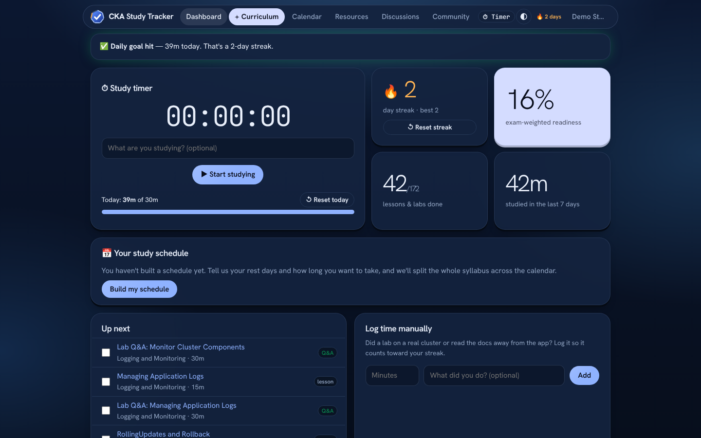
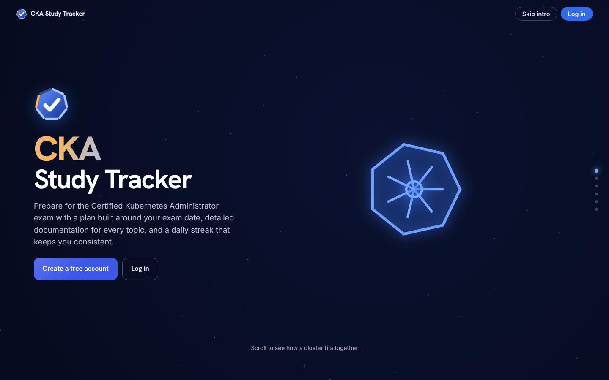
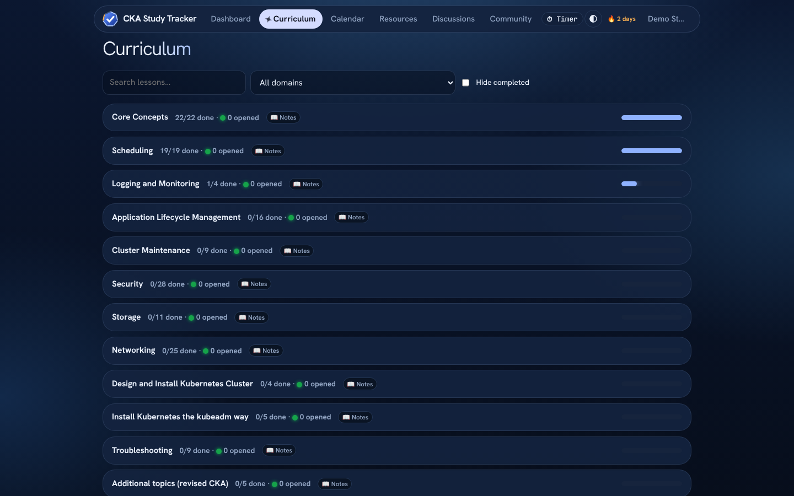
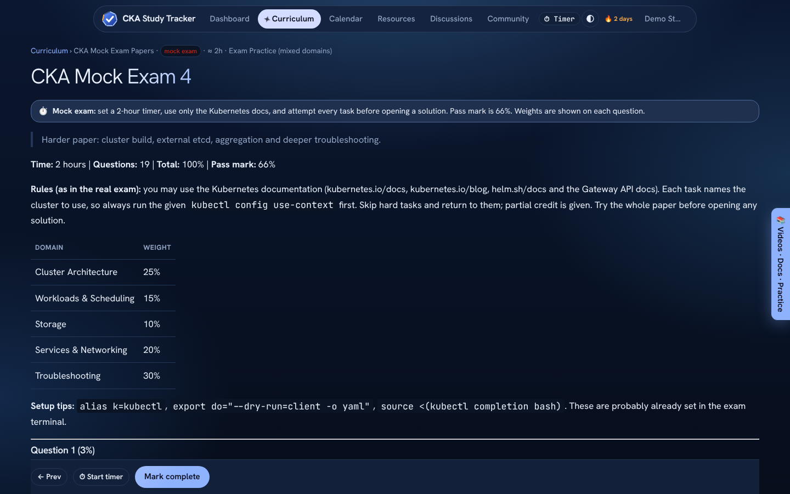
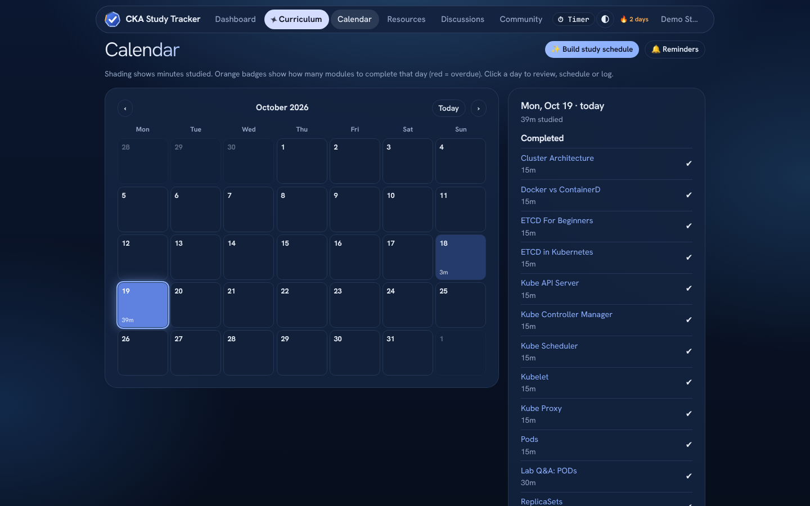
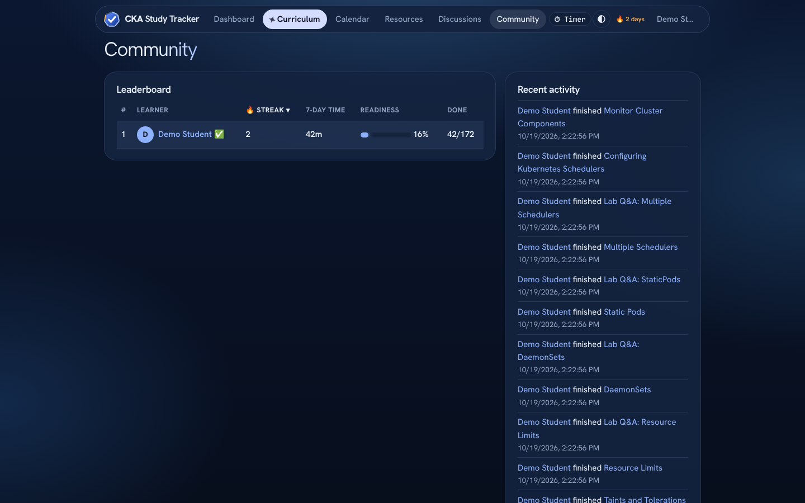
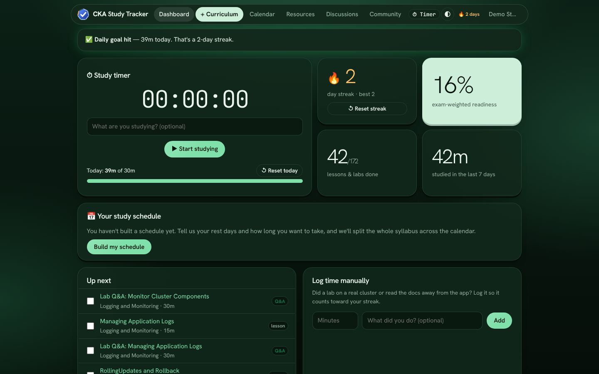
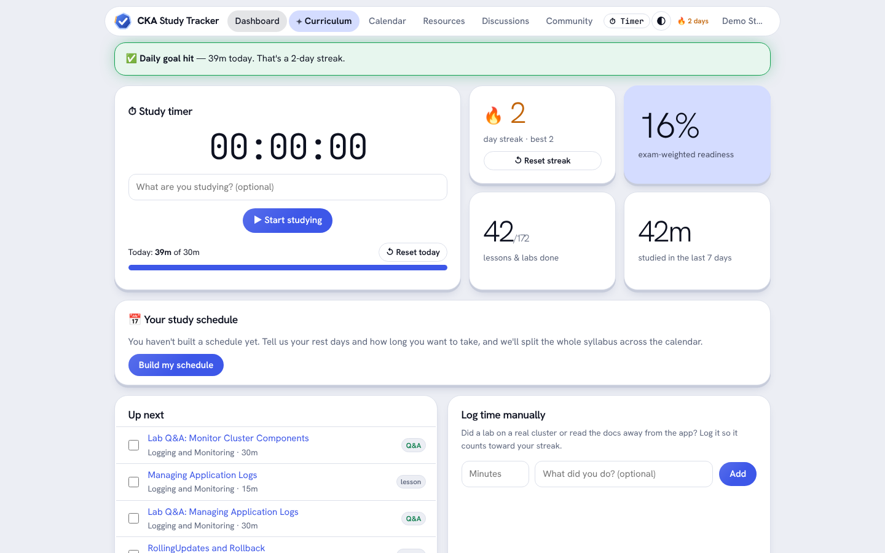

# CKA Study Tracker

A free, multi-user web app for preparing for the **Certified Kubernetes Administrator (CKA)** exam. It has a full curriculum with an in-app lesson reader, lab Q&A, four timed mock exam papers, a study calendar, streaks and a shared leaderboard.

**Live:** https://ckastudy.co.uk

> Unofficial community project. It is not affiliated with or endorsed by the CNCF, The Linux Foundation, KodeKloud or Udemy.

<p align="center">
  
</p>

## Screenshots

| | |
|---|---|
| <br>**Animated intro** | <br>**Dashboard**: timer, streak, exam-weighted readiness |
| <br>**Curriculum** with progress per section | <br>**Mock exam papers** with weights and collapsible solutions |
| <br>**Study calendar** heatmap and auto-plan | <br>**Community** leaderboard and activity feed |

### Themes
Four themes (Midnight, Forest, Graphite, Light), switchable from the top bar.

| Forest | Light |
|---|---|
|  |  |

## Features

- **Curriculum**: lessons and lab Q&A mapped to the CKA v1.35 domains, with an in-app reader, video embeds and per-lesson notes.
- **Mock exams**: 4 papers, 19 tasks each, using the real exam's domain weights (Cluster Architecture 25%, Workloads 15%, Storage 10%, Networking 20%, Troubleshooting 30%) with full solutions.
- **Exam-weighted readiness** score so you know what to study next.
- **Study timer**, manual time logging, streaks and nudges.
- **Calendar** heatmap, scheduling, and an auto-plan that spreads the syllabus to your exam date.
- **Reminders**: `.ics` daily reminder and browser notifications.
- **Community**: leaderboard, activity feed, public profiles (opt-out in Settings) and discussion channels.
- Accounts with scrypt-hashed passwords and session cookies.

## Run locally

Requires **Node 22.5+** (uses the built-in `node:sqlite`).

```bash
npm install
npm start            # http://localhost:3000
```

Data is stored in `data/cka.db` (override with `DATA_DIR`). Behind HTTPS set `COOKIE_SECURE=1`.

Docker:

```bash
docker build -t cka-tracker .
docker run -p 3000:3000 -v cka-data:/data cka-tracker
```

## Content scripts

```bash
npm run build:curriculum     # data/curriculum.json from content/docs
npm run build:guides         # content/guides.json from content/guide-src
node scripts/build-mocks.js  # mock exam pages from content/mock-src/exam*.txt
```

Domain weights are defined in `scripts/build-curriculum.js` (from the CNCF curriculum PDF).

## Deployment

Hosted on Fly.io (SQLite on a persistent volume). Every push to `main` deploys through GitHub Actions.

## Stack

Node, Express, `node:sqlite`, `marked`, and a vanilla JS single-page frontend.

## Support

If it helped you pass, you can [buy me a coffee](https://ko-fi.com/nayeeman49).
